# Encoderino

<p>
  <strong>Encoderino</strong> is a Windows desktop application for controlling
  system actions with an Arduino Uno and a rotary encoder.
</p>

<p>
  
  <strong>Hardware control</strong>
  &nbsp;&nbsp;
  
  <strong>Desktop control modes</strong>
  &nbsp;&nbsp;
  
  <strong>Automatic firmware flashing</strong>
</p>

## Overview

Encoderino combines three components:

1. **Arduino firmware** reads the rotary encoder and button, then sends simple
   commands over serial.
2. **The Python desktop application** reads those commands and maps them to
   Windows actions such as volume control, scrolling, zoom reset, media
   playback, and virtual desktop navigation.
3. **The bundled Arduino CLI** compiles and uploads the firmware without
   requiring the Arduino IDE.

The application can remain active in the Windows notification area after its
main window is closed. Serial reading and command handling continue while the
application is minimized to the tray.

## Features

- **Audio Master** mode: volume up, volume down, and play/pause.
- **Zoom/Scroll** mode with a latched five-second button modifier:
  - Normal rotation scrolls.
  - Hold the button for five seconds to switch to Zoom mode.
  - Rotate while Zoom mode is active to zoom in or out.
  - Hold the button for five seconds again to return to Scroll mode.
- **Virtual Desktops** mode is visible in the interface but is not yet
  functional.
- Serial-port discovery through `pyserial`.
- Firmware compilation and upload through the bundled `arduino-cli`.
- Automatic installation of the Arduino AVR core and the `Encoder` library.
- Real-time firmware operation logs in the application window.
- Safe serial-port handoff during firmware upload.
- System-tray operation through `pystray`.
- Portable ZIP distribution and per-user Windows installer.

## Hardware Requirements

- Arduino Uno
- Rotary encoder with push button
- USB cable for the Arduino Uno
- Five jumper-wire connections

### Rotary Encoder Pinout

| Rotary encoder pin | Arduino Uno pin | Description |
| --- | --- | --- |
| CLK (Pin A) | Digital 2 | Encoder clock; interrupt-capable |
| DT (Pin B) | Digital 3 | Encoder data; interrupt-capable |
| SW (Button) | Digital 4 | Push button; uses the internal pull-up |
| `+` / VCC | 5V | Power supply |
| GND | GND | Ground |

### Wiring Diagram

```text
ARDUINO UNO
     +-------------+
     |        GND o|-------- [ Encoder GND ]
     |         5V o|-------- [ Encoder VCC ]
     |     Pin 2  o|-------- [ Encoder CLK ]
     |     Pin 3  o|-------- [ Encoder DT  ]
     |     Pin 4  o|-------- [ Encoder SW  ]
     +-------------+
```

The firmware configures the button as `INPUT_PULLUP`. The button is therefore
active-low: pressing it connects Digital 4 to ground.

## Software Requirements

### Recommended: Windows distribution

Download one of the prepared packages from [Windows](./Windows/):

- [Encoderino-Windows-Installer-v1.0.0-beta2.exe](./Windows/Encoderino-Windows-Installer-v1.0.0-beta2.exe)
  installs Encoderino for the current Windows user and creates shortcuts.
- [Encoderino-Windows-Installer-v1.0.0-beta2.zip](./Windows/Encoderino-Windows-Installer-v1.0.0-beta2.zip)
  can be extracted and run without an installation step.

Both packages include the application, firmware source, and
`arduino-cli.exe`.

### Running from source

For development or local execution, install:

- Windows 10 or later
- Python 3.14 or a compatible supported Python version
- A connected Arduino Uno
- Internet access on the first firmware-flashing run, so Arduino CLI can
  install the AVR core and the `Encoder` library

Install the Python dependencies:

```powershell
python -m pip install -r requirements.txt
```

The repository includes the Windows Arduino CLI executable at:

```text
tools\arduino-cli\arduino-cli.exe
```

## Running Encoderino

From the repository root:

```powershell
python gui\main.py
```

1. Connect the Arduino Uno by USB.
2. Start Encoderino.
3. Select the Arduino COM port.
4. Click **Connetti**.
5. Select **Audio Master**.
6. Turn or press the rotary encoder to control Windows volume or media
   playback.

The application discovers available serial ports when it starts. Use the
refresh button if the Arduino is connected after the application launches.

To use **Zoom/Scroll** mode:

1. Select **Zoom/Scroll**.
2. Rotate the encoder to scroll.
3. Hold the encoder button for five seconds to activate Zoom mode.
4. Rotate right or left to zoom in or out.
5. Hold the encoder button for five seconds again to return to Scroll mode.

Encoderino updates the in-app status and log when the mode changes. If the
application is minimized to the system tray, it also displays a Windows tray
notification.

## Flashing the Firmware

The firmware source is located at [firmware/firmware.ino](./firmware/firmware.ino).

To flash it from the GUI:

1. Connect the Arduino Uno by USB.
2. Select its COM port in Encoderino.
3. Click **Compila e carica firmware**.
4. Review the firmware log for board detection, compilation, and upload
   results.

Encoderino automatically:

- Temporarily disconnects its serial reader so the COM port is available.
- Detects the board and its fully qualified board name.
- Installs or verifies the `arduino:avr` core.
- Installs or verifies the `Encoder` library.
- Compiles the firmware.
- Uploads it to the selected port.
- Reconnects the serial reader after the operation.

If the board is not detected, check the USB cable, selected COM port, and
Windows device permissions.

## System Tray Behavior

Clicking the window close button does not terminate Encoderino. It hides the
main window and leaves the serial reader and command handler running.

Use the tray icon menu to:

- **Open Encoderino**: restore the main window.
- **Exit**: close the serial connection and terminate the application.

To fully stop the application, use **Exit** from the tray menu rather than the
window close button.

## Architecture

```text
Rotary encoder
      |
      v
Arduino Uno firmware
      |
      | USB serial, 9600 baud
      v
Encoderino Python GUI
      |
      +--> Audio Master actions
      +--> Scroll and latched zoom actions
      +--> Virtual Desktop actions (planned)
      |
      +--> Arduino CLI compile/upload workflow
      +--> Windows system tray service
```

### Repository layout

```text
encoderino/
├── firmware/
│   └── firmware.ino
├── gui/
│   └── main.py
├── tools/
│   └── arduino-cli/
│       └── arduino-cli.exe
├── Windows/
│   ├── Encoderino-Windows-Installer-v1.0.0-beta2.exe
│   ├── Encoderino-Windows-Installer-v1.0.0-beta2.zip
│   └── Encoderino-Windows-Installer.exe
├── assets/
│   └── icons/
│       └── *-white.svg
├── Encoderino.spec
├── RELEASE_NOTES_v1.1.0.md
├── requirements.txt
└── README.md
```

## Building the Windows Application

PyInstaller is used to create the standalone onedir application. Install it
in the build environment, then run:

```powershell
python -m pip install pyinstaller
pyinstaller --clean --noconfirm Encoderino.spec
```

The output is created in:

```text
dist\Encoderino\
```

The spec file includes:

- The Python GUI and its dependencies.
- The firmware source directory.
- The bundled Arduino CLI directory.
- The `pystray` Windows backend.

The application uses the `_internal` directory produced by PyInstaller to
locate bundled firmware and Arduino CLI resources.

## Troubleshooting

### No COM port is shown

- Confirm that the Arduino Uno is connected.
- Try another USB cable or USB port.
- Close other serial-monitor applications.
- Click the refresh button in Encoderino.

### Firmware upload fails

- Ensure the selected port belongs to the Arduino Uno.
- Close Arduino IDE Serial Monitor and other applications using the port.
- Confirm that the board is powered and connected.
- Check the firmware log for the failing CLI command.

### Encoder actions do not work

- Confirm that the application status is connected.
- Verify the CLK, DT, SW, 5V, and GND wiring.
- Confirm that the selected operating mode matches the desired action.
- Check that Windows is not blocking simulated keyboard or mouse input.

## License

Encoderino is distributed under the MIT License. See [LICENSE](./LICENSE)
for the complete license text.
